<a id="top"></a>

<p align="center">
  
</p>

<p align="center">
  <a href="https://readme-typing-svg.demolab.com"></a>
</p>

<h3 align="center">Two live versions · same repository</h3>

| Version | Branch (source) | Live app | Status |
| :--- | :--- | :--- | :--- |
| **TwinSite Platform** · Standard mode **+ Expedition Mode** (live NASA data, Robust cleaning, 13 agents, Data Hub, 7-provider AI router, Mission Console, open APIs) — *this branch* | [`platform-integration`](https://github.com/hakim-AI-hub-88/AstroWinners-TwinSite/tree/platform-integration) | **[twinsite-visionary.onrender.com](https://twinsite-visionary.onrender.com/)** | ✅ **Live — production deployment.** Verified on the live URL: smoke test 27/27, full Expedition missions end to end with live NASA data, Data Hub retrieval/cleaning/downloads, live characterization. Render free (512 MB): first request after 15 min idle takes ~1 min. |
| **TwinSite Hackathon release** · Standard mode (the version submitted to NASA Space Apps 2026) | [`master`](https://github.com/hakim-AI-hub-88/AstroWinners-TwinSite/tree/master) | **[astrowinners-twinsite-1.onrender.com](https://astrowinners-twinsite-1.onrender.com/)** | ✅ **Live — submitted release.** Unchanged since submission. |

<p align="center">📘 <a href="docs/FINAL_REPORT.md"><strong>Full final report — both versions, every detail</strong></a> &nbsp;·&nbsp; ☁️ <a href="docs/deployment/FREE_HOSTING.md"><strong>Hosting guide</strong></a> &nbsp;·&nbsp; 🧭 <a href="#expedition"><strong>Expedition Mode</strong></a> &nbsp;·&nbsp; 🤝 <a href="#contribute"><strong>Contribute</strong></a></p>

<a id="expedition"></a>

## 🧭 Expedition Mode — the upgrade in one place

<p align="center"></p>

The original analysis stays as **Standard mode** (`/app`). Every new capability lives behind one door — **[`/expedition`](http://127.0.0.1:5050/expedition)** — with its own header: **Overview · Launch Expedition · Data Hub · Mission Console · Docs & APIs**.

| | Standard mode · `/app` | **Expedition Mode** · `/expedition` |
| :--- | :--- | :--- |
| **Data** | Bundled harmonized grids | Bundled grids **+ live NASA** (POWER, GIBS, CMR, LOLA, Diviner, MOLA, SRTM, terrain tiles, OSM) |
| **Cleaning** | Standard | **Robust** by default (median/MAD) · Strict · Standard · Raw, each with a removal report |
| **Run** | Interactive, one zone at a time | **Autonomous**: plan → acquire → clean → analyze every zone → agents → report |
| **Agents** | — | **13 roles** (6 deterministic, 7 AI); AI must cite evidence and never changes a score |
| **AI** | Groq assistant | **7 free providers** with fallback: Groq, Cloudflare, Google, OpenRouter, Mistral, NVIDIA, Ollama |
| **Data access** | — | **Data Hub** UI + `/api/data/*` REST: filter, page, clean, download CSV/JSON/original |

<details open>
<summary><strong>✅ Verified on this branch</strong></summary>

| Check | Result |
| :--- | :--- |
| Flask test suite | **39 / 39** pass |
| Mission Console (React) tests | **55 / 55** pass |
| Production smoke test (`ops/vm/smoke.py`) | **27 / 27** pass, including a real mission through the worker |
| Live Expedition run · Mars, Jezero · live data · Robust cleaning · AI on | All 6 steps complete · best Earth twins **Atacama 98.3**, **Merzouga 87.0** · 13 agents reported · report written by Groq |

</details>

---

<!-- Original cover -->

<p align="center">
  <a href="#launch">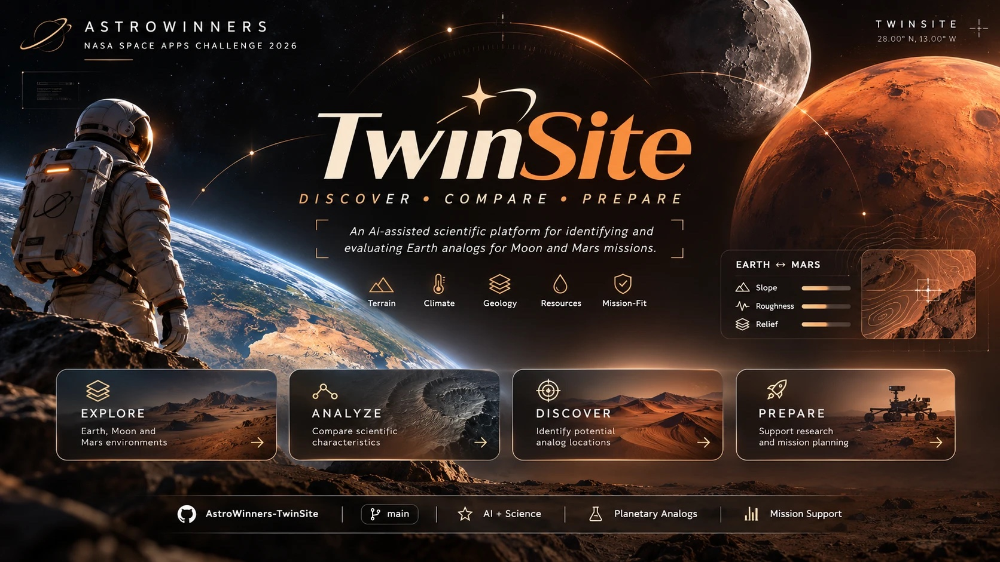</a>
  <br><sub><em>Cover artwork is illustrative, not an app screenshot. <a href="#what-ships-today">What ships today</a> is the implemented scope.</em></sub>
</p>

### Two live versions · same repository

| Version | Branch (source) | Live app | Status |
| :--- | :--- | :--- | :--- |
| **TwinSite Hackathon release** · Standard mode (the version submitted to NASA Space Apps 2026) — *this branch* | [`master`](https://github.com/hakim-AI-hub-88/AstroWinners-TwinSite/tree/master) | **[astrowinners-twinsite-1.onrender.com](https://astrowinners-twinsite-1.onrender.com/)** | ✅ **Live — submitted release.** |
| **TwinSite Platform** · Standard mode **+ Expedition Mode** (live NASA data, Robust cleaning, 13 agents, Data Hub, 7-provider AI router, Mission Console, open APIs) | [`platform-integration`](https://github.com/hakim-AI-hub-88/AstroWinners-TwinSite/tree/platform-integration) | **[twinsite-visionary.onrender.com](https://twinsite-visionary.onrender.com/)** | ✅ **Live — production deployment.** Smoke test 27/27 on the live URL; full Expedition missions run end to end with live NASA data. |

📘 **[Full final report — both versions, every detail](https://github.com/hakim-AI-hub-88/AstroWinners-TwinSite/blob/platform-integration/docs/FINAL_REPORT.md)**

<h3 align="center">Every mission to Mars or the Moon rehearses on Earth first.<br>TwinSite finds where.</h3>

<p align="center">Pick a crater on Mars or a landing site on the Moon. TwinSite scores Earth terrain in the <strong>Atacama Desert</strong> and Morocco's <strong>Merzouga dunes</strong> against it,
ranks the closest twins, explains every difference feature by feature, and turns the evidence into a printable mission dossier.</p>

<p align="center">
  
  
  <br>
  
  
  
  
  
  
</p>

<p align="center">
  <a href="#launch"><strong>🚀 Launch locally</strong></a> &nbsp;·&nbsp;
  <a href="#science"><strong>🔬 How the score works</strong></a> &nbsp;·&nbsp;
  <a href="docs/catalog.md"><strong>🛰️ Resource atlas</strong></a> &nbsp;·&nbsp;
  <a href="#horizon"><strong>🌌 Roadmap</strong></a>
</p>

<a id="what-ships-today"></a>
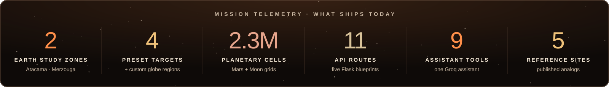

<p align="center">
  <picture>
    <source media="(prefers-reduced-motion: reduce)" srcset="docs/readme/assets/signal-static.png">
    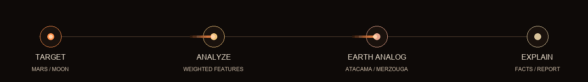
  </picture>
</p>

<p align="center">
  <a href="#flight-plan">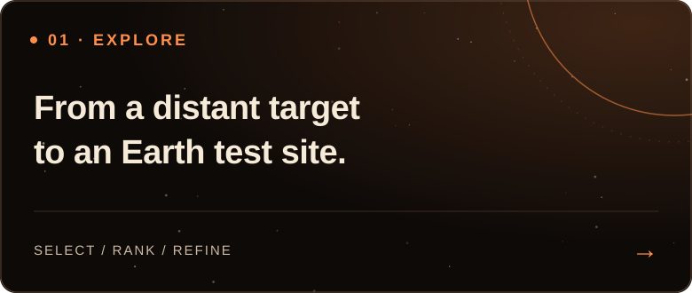</a>
  <a href="#science">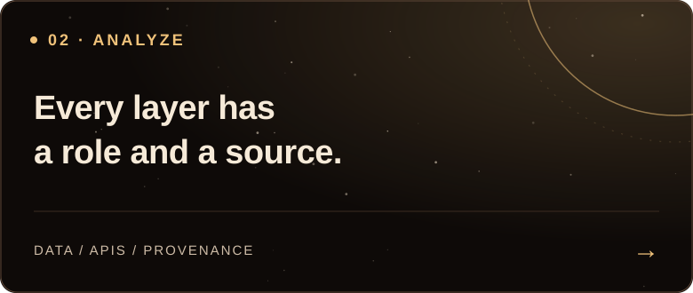</a><br>
  <a href="#architecture">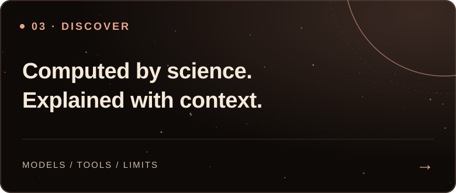</a>
  <a href="#reports">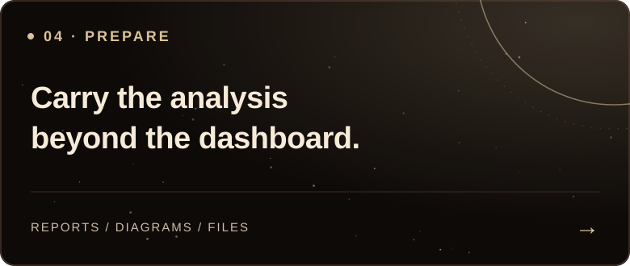</a>
</p>

<p align="center"><sub>
<a href="docs/catalog.md#api">HTTP APIs</a> · <a href="docs/catalog.md#data">Data sources</a> · <a href="docs/catalog.md#intelligence">AI &amp; models</a> · <a href="docs/catalog.md#reports">Reports</a> · <a href="docs/catalog.md#links">Research &amp; links</a> · <a href="docs/implementation.md">Implementation audit</a> · <a href="docs/inventory.md">Every repository file</a>
</sub></p>

> [!NOTE]
> **Scope, plainly.** Implemented today: two Earth study zones, four preset targets plus custom globe regions, deterministic similarity scoring and refinement, PCA and K-means views, five published reference sites, an AI assistant and printable reports — plus the TwinSite platform: [Agentic Auto Mode, the Data Hub, a multi-provider free-tier AI router, 13 agent roles, live NASA connectors and the Mission Console](#what-ships-now). AI is optional and never changes a number; the scientific release gate for the measured Zagora–Gale pair is **BLOCK**, and worldwide search remains a [future ambition](#horizon). TwinSite is an open research platform, live in production, and not a NASA-endorsed mission-planning system.

<a id="what-ships-now"></a>

## What ships now: the platform upgrade

One site, three processes: the Flask app (pages and `/api/*`), the TwinSite platform API (`/v1/*`) and a
mission worker. Every capability below states its limits; nothing is filled in when a source fails — the
API answers `status: "unavailable"` with a reason instead.

| Capability | Where | What it does | Limits, plainly |
| :--- | :--- | :--- | :--- |
| **Agentic Auto Mode** | [`/auto`](http://127.0.0.1:5050/auto) · `POST /api/auto/missions` | One request runs plan → acquire → clean → analyze (all Earth zones) → agents → report in the background, with every step's state visible | Steps that cannot run are marked `skipped`/`failed` with a reason; the agent step covers Moon/Mars targets with a custom lat/lon |
| **Data Hub API + cleaning** | [`/data`](http://127.0.0.1:5050/data) · `/api/data/*` | Browse every bundled dataset, per-column statistics and provenance; filter by bounding box; JSON or CSV downloads; cleaning profiles `raw`, `standard` (default, today's scores), `strict`, `robust` (median/MAD outliers) | Bundled `data_ready/` grids; live sources are listed alongside, explicitly unavailable when the platform API is down |
| **Multi-provider AI** | `/api/ai/status` | One router over free tiers — Groq, Cloudflare Workers AI, Google, Mistral, OpenRouter, NVIDIA NIM, Ollama Cloud — with fallback between them; the assistant keeps Groq tool-calling when a Groq key exists | Free tiers only, no paid inference; zero keys = AI reports "not configured" and deterministic paths still work |
| **13 agent roles** | `/v1/missions/{id}/agents` | A01–A13 across phases P10–P90: 6 deterministic (sources, cleaning, QA, audit, portfolio, release judge) and 7 AI roles (visual reading, scenarios, domain analysis, synthesis, evidence review, rechecks, report narrative) | AI output must cite existing evidence IDs or it is rejected; AI can never modify the committed result or release it |
| **Live NASA connectors** | `/v1/science/*` | Any point on Earth, the Moon or Mars characterized end to end: NASA POWER climatology, NASA GIBS imagery, CMR granule discovery, LRO LOLA and Diviner, MGS MOLA, LP DAAC SRTM (cached), AWS Terrain Tiles, NSSDCA constants, OpenStreetMap access (Earth) | Needs network; CMR results are discovery-only (no Earthdata download in the services); GIBS imagery is visual context, never a measurement |
| **Mission Console** | [`/console/`](http://127.0.0.1:5050/console/) | React console for live characterization, analog matching, portfolios, evidence, agent activity and reports | Scientific release for the measured pair is **BLOCK** ([review](docs/release/SCIENTIFIC_REVIEW.md)); demo fixtures are labelled synthetic |

<a id="flight-plan"></a>


## Explore → compare → understand

Start with **Jezero Crater**, where Perseverance landed. Choose your rover's slope limit. TwinSite analyzes **both Earth zones**, ranks candidate regions, explains the differences and proposes a finer test point where data permits. Switch zones, inspect a different candidate, then carry the evidence into a report.

| Mission station | What is implemented | Source |
| :--- | :--- | :--- |
| **Arrival** · `/` | Planetary hero, Earth/Moon/Mars imagery and entry into the workspace. | [Home](templates/home.html) |
| **Mission Control** · `/app#mission` | Two Cesium globes; target selection; layer controls; 2D/3D switching; similarity ring; confidence; ranked regions; physical comparisons; score breakdown; mission brief and copy action. | [Dashboard](templates/index.html) · [globe controller](static/js/twinmap.js) |
| **Site Explorer** · `/app#explorer` | Atacama and Merzouga Leaflet maps, target map, clickable cells, environmental radar, zone benchmark and synchronized region selection. | [Frontend](static/js/app.js) |
| **Science & Validation** · `/app#science` | PCA environment atlas, K-means terrain classes, body/type coloring, click-to-map exploration, post-hoc checks against published analog sites, methodology. | [Models](backend/services/ml_models.py) · [validation](backend/services/validation.py) |
| **Applications & Report** · `/app#applications` | Seven application cards with computed metrics and availability labels; printable mission dossier. | [Application logic](static/js/app.js) · [report service](backend/services/report.py) |
| **Mission assistant** · available across the dashboard | English/French conversational explanations, dashboard context, tool-use labels and report shortcut. Requires a Groq key and network. | [Assistant](backend/services/assistant.py) |

The four workspace pages share one document and keep the current analysis in memory. The sidebar, mission bar and assistant remain available across them.

<details>
<summary><strong>Choose a target · four presets, two zones, custom regions</strong></summary>

| Target | Coordinates · east-positive longitude | One-click scenario | Slope limit |
| :--- | :--- | :--- | :--- |
| Mars · Jezero Crater | 18.38°, 77.58° | Perseverance-class rover test | 15° |
| Mars · Gale Crater | −5.40°, 137.80° | Curiosity-class drive & drill | 15° |
| Moon · Apollo 15 | 26.13°, 3.63° | Astronaut EVA + lunar rover training | 10° |
| Moon · Mare Tranquillitatis | 8.50°, 31.40° | Lander site rehearsal | 8° |

**Custom regions:** click the target globe. The analysis uses a circle with radius **25, 50 or 100 km**, displayed as an enclosing **50, 100 or 200 km** square. The region check reports cell count, usable features and physical values before analysis. Its three-feature precheck is less strict than the engine's four-feature requirement; “analysable” is not a guarantee of a ranking.

**Earth search areas:** Atacama, Chile (25–22° S, 70–66° W; default), and Merzouga–Erg Chebbi, Morocco (30–32° N, 5–3° W). These are bounded study areas, not a worldwide search. [Configuration](backend/utils/config.py) · [custom-region implementation](backend/services/layers.py).

</details>

<details>
<summary><strong>Open the seven application cards · implemented answers and their limits</strong></summary>

| Card | What the code actually provides |
| :--- | :--- |
| Analog field testing | Top regions, similarity and a refined Earth point when one qualifies. |
| Rover traverse | Slope-based accessible share and terrain statistics; not a traversability simulation or route planner. |
| Thermal environment | Target/test-site day/night values and thermal swing; some target values are modeled. |
| Surface material | Mars-only heuristic classification from thermal inertia. No comparable Earth thermal-inertia map; lunar classification unavailable. |
| Lunar cold traps | Preliminary lunar temperature check against 110 K; not ice detection or a full cold-trap survey. |
| Habitat site assessment | Slope, thermal swing and Mars iron when available; not a habitat design or construction suitability model. |
| Science communication | Similarity, closest features, largest differences and comparative charts. |

These cards exist in [useCaseAnswers](static/js/app.js). Their presence does not mean all seven scientific problems are solved.

</details>

<a id="science"></a>
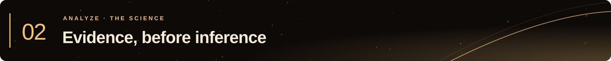

## A similarity score you can inspect

**100 means an identical profile on the shared normalized feature scale. It is not a probability of mission success.** The score uses surface properties; it does not reproduce gravity, atmosphere, pressure or radiation.

```text
effective weight = nominal weight × (1 − 0.30 × target uncertainty)
                                  × (1 − 0.30 × Earth-cell uncertainty)

distance = √( Σ effective_weight × (Earth_feature − target_mean)²
              / Σ effective_weight )
score    = 100 × (1 − distance)
```

1. Average the normalized cells within the target's circular window (50 km for presets).
2. Compare available shared features; require at least four. Exclude elevation because the bodies use different reference surfaces. Reject Earth cells missing any selected feature.
3. Rank up to ten regions, at least 25 km apart. The optional rover filter admits regions where at least 50% of land cells meet the chosen 5–30° slope limit; it **does not alter scores**.
4. Refine each region using the processed Earth grid: exclude water and steep cells, then minimize day/night temperature mismatch. If target temperatures are unavailable, use the lowest qualifying slope. A qualifying point may be absent.
5. Explain each feature's share of weighted squared distance, physical values, missing features and confidence. The interface allocates the lost score points using those shares; this is an attribution convention, not an independent additive physical model.

| Data role | Resolution / scale | Used for |
| :--- | :--- | :--- |
| [Harmonized, normalized](data_ready/harmonized/) | ~11 km regions · common 0–1 scale | Similarity and model features |
| [Harmonized, physical](data_ready/harmonized/validation_report.md) | Same regions · K, degrees, meters, albedo, TIU, Fe wt% | Explanations, tables and display layers |
| [Processed Earth](data_ready/earth/processed/) / [Merzouga](data_ready/merzouga/processed/) | ~1 km cells | Rover eligibility and refined points |

**Confidence** measures available effective feature weight relative to all planned feature weight. It is an evidence-coverage indicator, not a calibrated statistical certainty. [Engine](backend/services/similarity_engine.py) · [refinement](backend/services/refinement.py) · [full scientific notes](docs/implementation.md#science).

<details>
<summary><strong>Inspect coverage, models and validation</strong></summary>

The bundled [harmonization report](data_ready/harmonized/validation_report.md) records **1,200 Atacama**, **400 Merzouga**, **1,843,200 Mars** and **460,800 Moon** rows. Rows are grid cells, not all complete observations. Mars has nine populated feature columns; Earth zones and Moon have seven. Thermal inertia and iron are absent for the Earth zones and Moon, and elevation is excluded from scoring, leaving six usual shared scoring features.

**Two independent model views:** PCA projects six environmental features into two dimensions. K-means uses slope, roughness and relief, selecting `k` from 3–6 by silhouette score. Training samples up to 3,000 cells per body; K-means weights balance the bodies, while PCA fits the sampled rows without these weights. Merzouga is projected through the same fitted models. These models do not determine the similarity score.

**Five published reference sites:** Licancabur, Yungay and Salar de Pajonales in the Atacama; the MARS2013 Weyprecht and Payer camps near Merzouga. Validation finds the closest scored cell within 30 km, its percentile and the nearest ranked region. Reference sites never train the models or change the ranking. A low Yungay rank can reflect missing aridity features, not a failed field study. [Sources and coordinates](backend/data/validation_sites.json).

**Limits carried into the documentation:** modeled Mars temperatures; measured and estimated lunar temperatures; lunar albedo proxy; coarse NASA POWER albedo; unresolved dunes/boulders; incomplete coverage; limited study areas; no terrain-displaced Cesium surface. Scores depend on target, features, data and filter settings. Old README example scores are not treated as a new benchmark.

</details>

<a id="architecture"></a>


## Follow a result to its source

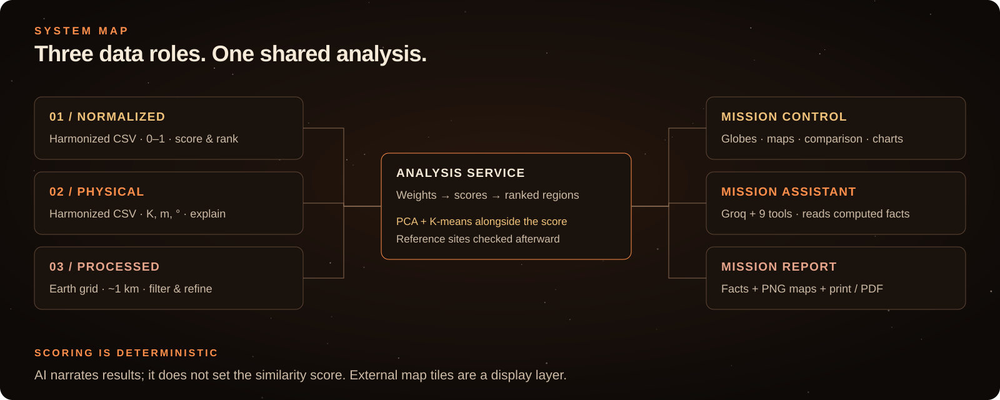

The application is **Flask + pandas/NumPy + scikit-learn + vanilla JavaScript**, with CesiumJS 1.140.0, Leaflet 1.9.4 and Chart.js 4.4.1 in the browser. Pillow generates report maps. Groq is the only implemented LLM provider; `openai/gpt-oss-120b` is its configured default model identifier, not a direct OpenAI API integration.

| Open a subsystem | Explore |
| :--- | :--- |
| **11 HTTP API routes** | [Methods, request fields, responses and examples](docs/catalog.md#api) |
| **Scientific data & map services** | [Product provenance, bundled files, tiles and missing datasets](docs/catalog.md#data) |
| **AI & ML** | [Provider configuration, all nine assistant tools, PCA and K-means](docs/catalog.md#intelligence) |
| **Source code** | [Component-by-component implementation audit](docs/implementation.md) |
| **Complete file map** | [Every file in the audited base snapshot](docs/inventory.md) |

<details>
<summary><strong>Expand the live Markdown architecture diagram</strong></summary>

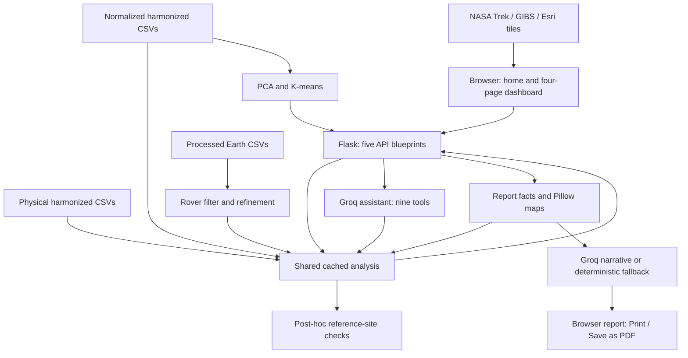

[Diagram guide & rendering constraints](docs/readme/README.md) · [API catalog](docs/catalog.md#api)

</details>

<a id="reports"></a>


## Keep the evidence with the recommendation

The report service analyzes both zones, assembles computed facts and draws local PNG similarity maps. Groq can write the narrative from these facts; without a usable key or provider connection, a deterministic summary is used. The browser adds rankings, comparisons, radar, available PCA plots, globe captures, application cards, validation and methodology, then opens **Print / Save as PDF**.

This is a browser print workflow, not a server PDF endpoint. Reports are generated on demand; no committed mission-report PDF is claimed. [Report implementation](backend/services/report.py) · [all bundled validation and processing reports](docs/catalog.md#reports).

<a id="horizon"></a>


## Ambitious by design. Precise about what ships.

| Future ambition — not implemented | What exists now | What would justify changing the label |
| :--- | :--- | :--- |
| ~~13 specialized AI agents~~ → **shipped as 13 agent roles** ([details](#what-ships-now)) | 6 deterministic + 7 AI roles with evidence-cited output; AI runs only with free-provider keys | Independent evaluation of AI role quality |
| ~~Live scientific API ingestion~~ → **shipped for point characterization** | POWER, GIBS, CMR discovery, LOLA, Diviner, MOLA, SRTM, terrain tiles, OSM via `/v1/science/*`, SHA-256-verified and cached | Geology/mineralogy sources and Earthdata-authenticated downloads in the services |
| **More Earth analog zones / worldwide discovery** | Atacama and Merzouga only | New zone data, configuration, coverage and validation |
| **Earth thermal inertia and mineral data; lunar H-parameter and iron** | Schema fields and explicit missing-data handling | Comparable datasets populated and scientific assumptions documented |
| **Finer albedo and 30 m terrain refinement** | Coarse POWER albedo, ~11 km scoring, ~1 km refined points | Higher-resolution sources and a tested method |
| **User-adjustable feature weights** | Weights live in Python configuration | UI and API controls with constraints and validation |
| **Stronger scientific validation** | Post-hoc ranking checks at five reference sites; bundled model reports | Independent field evidence, sensitivity analysis and reproducibility benchmarks |
| **Visual similarity** | Multi-provider free-tier text router shipped; matching is feature-distance only | Image-model integration and evaluation |

No delivery dates are implied for the remaining rows. See the [scope audit](docs/implementation.md#future) before promoting an ambition to an implemented capability.

<a id="launch"></a>

## Launch locally

Use **Python 3.11+** and **Node.js 20+** (Node only to build the console). Run from a normal full clone; the repository already contains `data_ready/`.

```bash
git clone https://github.com/hakim-AI-hub-88/AstroWinners-TwinSite.git
cd AstroWinners-TwinSite
make setup        # .venv + requirements.txt (Flask, gunicorn, jsonschema, pandas, scikit-learn ...)
make console      # optional: build the React Mission Console into frontend/dist (served at /console/)
make dev          # Flask :5050 + platform API :8080 + worker; Ctrl+C stops all three
```

Open **[http://127.0.0.1:5050](http://127.0.0.1:5050/)** — Home, [Mission Control](http://127.0.0.1:5050/app), [Auto Mode](http://127.0.0.1:5050/auto), [Data Hub](http://127.0.0.1:5050/data), [Console](http://127.0.0.1:5050/console/), [Resources](http://127.0.0.1:5050/resources).
Ports taken? `make dev WEB_PORT=5051 API_PORT=8091`. Flask alone: `make web` (or `python backend/app.py`). Tests: `make test-all`.

<a id="configuration"></a>

### Configuration

Copy [`.env.example`](.env.example) to `.env` (git-ignored); `make dev` reads it, and shell variables win. **Every key is optional** — with none, deterministic analysis, reports and the platform run and AI features say "not configured". Provider keys stay on the server (`GROQ_API_KEY`, `CLOUDFLARE_API_TOKEN` + `CLOUDFLARE_ACCOUNT_ID`, `GOOGLE_API_KEY`, `MISTRAL_API_KEY`, `OPENROUTER_API_KEY`, `NVIDIA_NIM_API_KEY`, `OLLAMA_API_KEY`); prompts built from computed facts are sent to the provider when AI features are used. Production keeps keys in a 0600 file named by `TWINSITE_AI_SECRET_ENV_FILE`. Runtime variables: `APP_PORT`, `TWINSITE_API_URL`, `TWINSITE_DATA_DIR` (SQLite, blobs, Auto Mode state; default `.runtime/`), `DATA_READY_DIR`, `TWINSITE_CORS_ORIGINS`.

<a id="deployment"></a>

### Deployment

**Free one-container deploy:** the repo ships a `Dockerfile` and `render.yaml`. Fastest: a Render Blueprint on this branch (builds from GitHub); roomiest free host: Hugging Face Spaces (Docker, 16 GB RAM, data pushed with LFS) — see the [free hosting guide](docs/deployment/FREE_HOSTING.md). **Vercel is not needed**: Flask serves every page and the built console.

A persistent Linux VM also works: nginx → gunicorn Flask (5050) for pages and `/api`, `/v1` → platform API (8080), plus the worker, under systemd — [VM runbook](ops/vm/README.md) (`ops/vm/install.sh`, seeding, smoke test, TLS). [Vercel](docs/deployment/VERCEL.md) can front it as the edge (domain, TLS, CDN for `/static`); the worker, SQLite and ~260 MB of data need the VM.

<details>
<summary><strong>Flask variables, dependencies and first checks</strong></summary>

| Variable | Default / purpose |
| :--- | :--- |
| `APP_HOST`, `APP_PORT`, `APP_DEBUG` | `127.0.0.1`, `5050`, `0`; debug only when exactly `1` |
| `DATA_READY_DIR` | Repository `data_ready/`, or sibling `../pipeline/data_ready/` if absent |
| `HARMONIZED_DATA_DIR` | `DATA_READY_DIR/harmonized/` |
| `EARTH_PROCESSED_FILE` | Atacama processed CSV under `DATA_READY_DIR` |
| `MERZOUGA_PROCESSED_FILE` | Merzouga processed CSV under `DATA_READY_DIR` |
| `GROQ_API_KEY`, `GROQ_MODEL` | Optional assistant/report credentials; default model `openai/gpt-oss-120b` |

**Path and server overrides must be exported before startup.** The minimal `.env` loader runs after those settings are read, so `.env` is reliable for Groq settings, not earlier configuration values. The upstream data-processing scripts mentioned by older notes are not included in this repository.

```bash
curl http://127.0.0.1:5050/api/status
curl http://127.0.0.1:5050/api/zones
curl -X POST http://127.0.0.1:5050/api/similarity \
  -H 'Content-Type: application/json' \
  -d '{"planet":"mars","location":"Jezero Crater","zone":"atacama","rover_mode":true,"max_slope":15}'
```

Startup loads the bundled datasets and fits models; time and memory depend on the machine. Browser libraries, fonts and external map imagery use CDNs/services, so an uncached full interface needs a network connection. Numerical analysis reads local data; live AI and live NASA characterization also need a network connection. `make dev` uses the Flask development server; production uses gunicorn behind nginx ([VM runbook](ops/vm/README.md)).

</details>


<a id="contribute"></a>

## 🤝 Contribute — the next steps are open

TwinSite was built for the NASA Space Apps Challenge and is open source under MIT. Good first contributions, in the order we would take them:

1. **More Earth analog zones** — Iceland, Hawaiʻi, Devon Island, Antarctic Dry Valleys (zone config + data + validation sites).
2. **Earth thermal inertia and mineralogy** so iron and TI enter Earth–Mars scoring.
3. **Earthdata-authenticated downloads** in the live connectors (CMR is discovery-only today).
4. **User-adjustable feature weights** in Expedition Mode, with constraints and a sensitivity report.
5. **Visual similarity** — image-model comparison of GIBS / HiRISE / LROC imagery, evaluated against field sites.
6. **Independent scientific validation** of agent outputs and the release gate.

Open an issue, read [CONTRIBUTING.md](CONTRIBUTING.md), and run `make test-all` before a pull request. The full roadmap is in the [final report](docs/FINAL_REPORT.md).

<a id="docs"></a>

## Docs, license, contributing

- **Final report (both versions):** [docs/FINAL_REPORT.md](docs/FINAL_REPORT.md)
- **Documentation index:** [docs/README.md](docs/README.md) — guides, architecture, [integration spec](docs/INTEGRATION_SPEC.md), deployment, [status](docs/status/INTEGRATION_STATUS.md), contracts.
- **License:** [MIT](LICENSE). Bundled data keeps its original source terms and attribution ([data credits](docs/catalog.md#credits)).
- **Contributing:** see [CONTRIBUTING.md](CONTRIBUTING.md) — `make test-all` must pass, and every claim must match what the code does. Security issues: [SECURITY.md](SECURITY.md).

---

<p align="center"><strong>Earth is the rehearsal. The next world is the mission.</strong><br>
<sub>Cover artwork supplied by the TwinSite team (illustrative) · Diagrams generated in code · Inspired by <a href="https://github.com/desagencydes-rgb">desagencydes-rgb</a> · <a href="docs/catalog.md#credits">Image credits &amp; source rights</a><br>
GitHub-native links, disclosures, SVG diagrams and GIF motion. The interactive 3D globes run in TwinSite, not inside this README.<br>
<a href="docs/readme/README.md">Design &amp; preview notes</a> · <a href="#top">Back to orbit ↑</a></sub></p>
