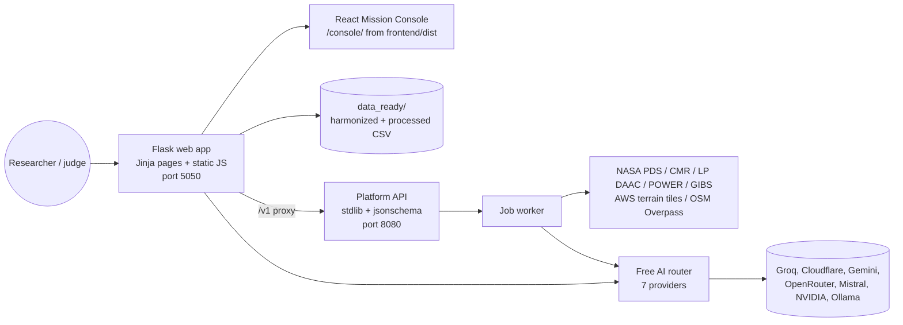
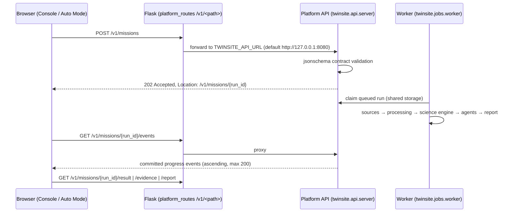
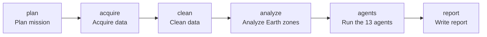
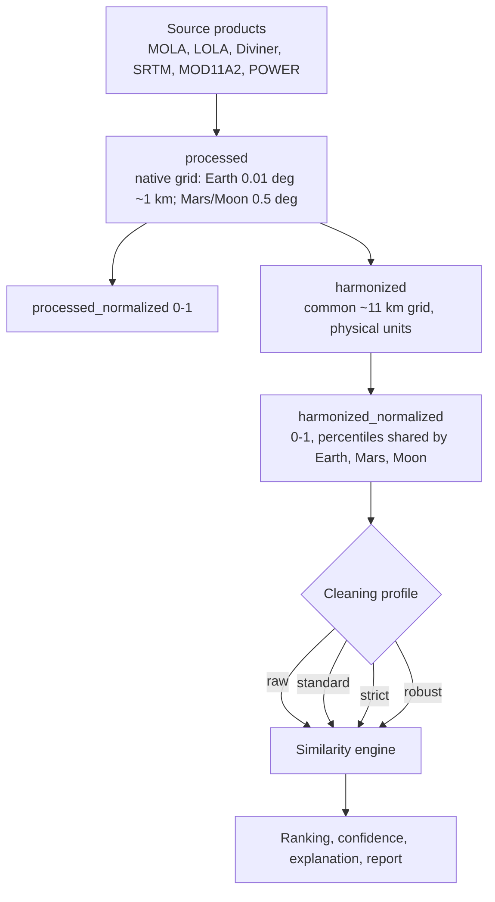

# TwinSite — Final Project Report (master + platform-integration)

     

**Live production app (master):** <https://astrowinners-twinsite-1.onrender.com/>
**Repository:** `hakim-AI-hub-88/AstroWinners-TwinSite` — branches `master` (production hackathon app) and `platform-integration` (visionary prototype).

## Table of contents

1. [Executive summary](#1-executive-summary)
2. [Challenge and team](#2-challenge-and-team)
3. [Version comparison](#3-version-comparison-master-vs-platform-integration)
4. [Architecture](#4-architecture)
5. [Pages and routes](#5-pages-and-routes)
6. [API endpoints](#6-api-endpoints)
7. [Datasets and data sources](#7-datasets-and-data-sources)
8. [Algorithms](#8-algorithms)
9. [The 13 agents](#9-the-13-agents)
10. [AI providers and fallback](#10-ai-providers-and-fallback)
11. [Security and privacy](#11-security-and-privacy)
12. [Testing and verification](#12-testing-and-verification)
13. [Tech stack and dependencies](#13-tech-stack-and-dependencies)
14. [Repository structure](#14-repository-structure)
15. [Deployment options](#15-deployment-options)
16. [Known limitations](#16-known-limitations)
17. [Roadmap and contribution ideas](#17-roadmap-and-contribution-ideas)
18. [Credits and license](#18-credits-and-license)

---

## 1. Executive summary

TwinSite finds **Earth analog sites for Mars and Moon targets**. Given a planetary target (a preset such as Jezero Crater or a region clicked on a globe), it compares terrain and thermal properties against harmonized Earth study zones (Atacama Desert, Chile, and Merzouga / Erg Chebbi, Morocco) and returns ranked, explainable similarity scores with a confidence value, physical comparisons and a printable mission dossier.

Two versions exist:

- **`master` — production hackathon app.** Flask + Jinja + CesiumJS/Leaflet, harmonized `data_ready/` datasets (Mars/Moon grid of roughly 2.3 M cells, Earth zones Atacama + Merzouga), weighted quality-aware similarity engine, PCA / K-means views, a Groq AI assistant with nine tools, and mission dossier reports. Deployed on Render.
- **`platform-integration` — visionary prototype.** Everything in master plus the full TwinSite platform: **Agentic Auto Mode** (plan → acquire data → clean → analyze every Earth zone → 13 agents → AI-written report), a **Data Hub** with 16 catalogued datasets and downloads, **four cleaning profiles**, per-mission data-source and cleaning choices, a **7-provider free AI router** (keys server-side only), a stdlib **platform API** (`/v1`, proxied by Flask) plus **job worker**, a **React/Vite Mission Console** at `/console/`, an expanded landing page, `/resources`, `/sitemap`, `/policy`, LICENSE, VM ops (`ops/vm`), `vercel.json`, Makefile and GitHub CI.

**Two modes on platform-integration.** The branch is organised so that all new platform features live under one opt-in **Expedition Mode**, with its own landing page `/expedition` and its own header (Overview `/expedition`, Launch `/auto`, Data Hub `/data`, Mission Console `/console/`, Resources, and a link back to Standard mode). The main site navigation is Home, Mission Control, Expedition Mode, Resources. **Standard mode** is the original master app (bundled data, standard cleaning, no agents). **Expedition Mode** defaults: live NASA data + bundled, Robust cleaning, agentic run with AI on.

Verified on platform-integration: Flask tests **39/39**, console tests **55/55**, VM smoke **27/27** (including a real mission through the worker), and a live Auto Mode mission for Mars / Jezero with Robust cleaning: best Earth matches **Atacama 98.3** and **Merzouga 87.0**, **13 agents reported**, report written by **Groq**.

## 2. Challenge and team

- **Event:** NASA Space Apps Challenge 2026.
- **Team:** AstroWinners (repository owner `hakim-AI-hub-88`).
- **Problem addressed:** selecting Earth analog sites for planetary mission preparation (rover traverse testing, instrument and thermal testing, ice / soil / outreach applications) is slow and qualitative. TwinSite makes it quantitative, explainable and evidence-cited using open NASA, USGS and OpenStreetMap data.
- **Scope statement (from master README):** TwinSite is a research prototype, not a NASA-endorsed mission-planning system. On master the 13-agent platform, live data ingestion and worldwide search were stated as future ambitions; the platform-integration branch implements them as a prototype.

## 3. Version comparison (master vs platform-integration)

On platform-integration, **Standard mode** reproduces master; **Expedition Mode** is the opt-in layer holding every new platform feature.

| | Standard mode (= `master`) | Expedition Mode (`platform-integration`) |
|---|---|---|
| Entry point | `/` and `/app` | `/expedition` (Overview) with its own header |
| Navigation | Home, Mission Control, Expedition Mode, Resources | Overview, Launch (`/auto`), Data Hub (`/data`), Mission Console (`/console/`), Resources, back to Standard mode |
| Data source default | Bundled `data_ready/` | Live NASA data + bundled |
| Cleaning default | Standard | Robust |
| Agents / AI | No agents (assistant only) | Agentic run, 13 agents, AI on |

Feature by feature:

| Feature | Standard mode / `master` | Expedition Mode / `platform-integration` |
|---|---|---|
| Landing page `/` | Arrival hero with Earth/Moon/Mars imagery | Expanded landing page, footer, links to Auto Mode, Data Hub, Console, Resources |
| Mission Control `/app#mission` | Two Cesium globes, targets, layers, 2D/3D, similarity ring, confidence, ranking, score breakdown, brief | Same, plus per-mission data source (bundled vs bundled + live NASA) and cleaning profile choices |
| Site Explorer `/app#explorer` | Leaflet maps of Atacama + Merzouga, radar, benchmark | Same |
| Science & Validation `/app#science` | PCA atlas, K-means classes, validation vs published analog sites | Same |
| Applications & Report `/app#applications` | Seven application cards, printable dossier | Same |
| AI assistant | Groq only, nine tools, EN/FR | Groq with tools when configured; otherwise the free multi-provider router answers without tools |
| AI providers | 1 (Groq, default model `openai/gpt-oss-120b`) | 7 chat providers (Groq, Cloudflare Workers AI, Google Gemini, OpenRouter free models, Mistral, NVIDIA NIM, Ollama Cloud) + ElevenLabs speech entry |
| Agents | One assistant + one narrative call | 13 role-defined agents (A01–A13) with deterministic release gate |
| Agentic Auto Mode `/auto` | — | Plan → Acquire → Clean → Analyze → 13 agents → Report; Launch / Stop / New |
| Data Hub `/data` + `/api/data/*` | — | 16 datasets, filter/page, clean, download CSV/JSON/original, curl/Python examples, live NASA sources |
| Cleaning profiles | Implicit (flag down-weighting) | raw / **standard (default)** / strict / robust with per-step removal reports |
| Platform API | — | Stdlib HTTP server + jsonschema, `/v1/*`, OpenAPI document, proxied by Flask |
| Job worker | — | `backend/twinsite/jobs/worker.py` executes queued missions |
| React Mission Console `/console/` | — | React 18 + Vite 6 + MapLibre + TanStack Query, served by Flask from `frontend/dist` |
| Resources hub `/resources` | — | Guides, docs, 4 architecture diagrams, stack, dependencies, APIs, agents, algorithms, data sources |
| `/sitemap`, `/sitemap.xml`, `/robots.txt`, `/policy` | — | Yes |
| LICENSE | Not present on master | MIT |
| Ops | `.env.example` | `ops/vm` (install.sh, nginx, 3 systemd units, smoke.py), `ops/secret_scan.py`, `ops/verify.sh`, AI probe, coverage matrix |
| Build tooling | `requirements.txt` | Makefile, `requirements-integration.txt`, `vercel.json`, `.github/workflows/ci.yml` |
| Contracts | — | `contracts/` (FREEZE.json, FRONTEND_ROUTES.json, SHARED_CONTRACT.md, `v1` schemas, `types.ts`, examples) |
| Hosting | Render (live) | Single Flask process serves everything; VM, container, free hosts; Vercel optional |

## 4. Architecture

### 4.1 System context



### 4.2 Request flow: Flask → /v1 proxy → platform API → worker



### 4.3 Auto Mode pipeline



Each step records `pending / running / done / skipped / failed` with a reason; a failing step never stops the mission. A mission errors only if neither the bundled analysis nor the platform agents produced a result. Data modes: `bundled`, `auto` (bundled + live NASA). Cleaning: `standard`, `raw`, `strict`, `robust`. Concurrency and agent timeout come from `TWINSITE_AUTO_MAX_CONCURRENT` (default 2) and `TWINSITE_AUTO_AGENTS_TIMEOUT_S` (default 360). Missions interrupted by a server restart are marked as such.

### 4.4 Data and cleaning pipeline



## 5. Pages and routes

| Path | Version | Purpose |
|---|---|---|
| `/` | both | Landing / arrival page (`templates/home.html`) |
| `/app` (`#mission`, `#explorer`, `#science`, `#applications`) | both | Main dashboard (`templates/index.html`, `static/js/app.js`, `static/js/twinmap.js`) |
| `/expedition` | platform | Expedition Mode landing page (Overview) and header |
| `/auto` | platform | Agentic Auto Mode (Expedition "Launch") |
| `/data` | platform | Data Hub |
| `/resources` | platform | Guides, docs, diagrams, stack, APIs, agents, algorithms, data sources |
| `/sitemap` | platform | Human sitemap |
| `/policy` | platform | Privacy / usage policy |
| `/sitemap.xml`, `/robots.txt` | platform | Crawlers |
| `/console`, `/console/`, `/console/<path>` | platform | React Mission Console (SPA fallback to `index.html`) |
| `/v1/<path>` | platform | Proxy to the platform API (GET, POST, PUT, DELETE, OPTIONS) |

Console pages (from `frontend/src/pages` and `contracts/FRONTEND_ROUTES.json`) include Activity, Analysis and DataCatalog among others; components include PlanetGlobe, PlanetMap, EarthMap, LocationPicker, MissionDashboard, AgentActivity, ReleaseGate, ScienceGateway, TerrainViz, Scatter, Progress and SelectedSite.

## 6. API endpoints

### 6.1 Flask API (master = first 11 rows; master README counts "11 HTTP API routes")

| Method | Path | Version | Purpose |
|---|---|---|---|
| GET | `/api/zones` | both | Earth study zones |
| GET | `/api/targets` | both | Preset Mars / Moon targets |
| GET | `/api/status` | both | Data and service status |
| POST | `/api/similarity` | both | Score Earth cells against a target |
| GET | `/api/ml` | both | PCA environment atlas + K-means terrain classes |
| POST | `/api/report` | both | Mission dossier (facts, AI or deterministic narrative, map PNGs) |
| POST | `/api/assistant` | both | AI Mission Assistant |
| GET | `/api/assistant/status` | both | Assistant configuration |
| GET | `/api/layers` | both | Globe data layers |
| GET | `/api/layer/<body>/<feature>.png` | both | Rendered layer image |
| GET | `/api/region-info` | both | Coverage check for a clicked globe region |
| GET | `/api/data/datasets` | platform | List the 16 datasets |
| GET | `/api/data/datasets/<id>` | platform | Dataset metadata and statistics |
| GET | `/api/data/datasets/<id>/records` | platform | Filter / page / clean records; `format=csv|json`, `columns`, `cleaning`, bbox |
| GET | `/api/data/datasets/<id>/file` | platform | Original file download |
| GET | `/api/data/cleaning` | platform | Describe every cleaning profile |
| POST | `/api/data/clean` | platform | Run a cleaning profile and return the removal report |
| GET | `/api/data/sources` | platform | Live NASA / open data sources |
| POST | `/api/auto/missions` | platform | Launch an Auto Mode mission |
| GET | `/api/auto/missions` | platform | List missions |
| GET | `/api/auto/missions/<mission_id>` | platform | Mission state, steps, results, agents, report |
| GET | `/api/ai/status` | platform | AI router provider status (no secrets) |

Record limits: JSON 5,000 rows, CSV 200,000 rows. Invalid ids return 404; path-traversal ids such as `../../etc` are rejected (covered by tests).

### 6.2 Platform API `/v1` (from `backend/twinsite/api/openapi.json`)

| Method | Path | Purpose |
|---|---|---|
| GET | `/v1/health` | Readiness (AI and uploads disabled by default) |
| POST | `/v1/missions` | Queue a mission run (explicit user action only); 202 + Location |
| GET | `/v1/missions/{run_id}` | Run status |
| GET | `/v1/missions/{run_id}/events` | Committed progress events, ascending, at most 200 |
| GET | `/v1/missions/{run_id}/result` | Result |
| GET | `/v1/missions/{run_id}/evidence` | Evidence |
| GET | `/v1/missions/{run_id}/report` | Report |
| POST | `/v1/missions/{run_id}/cancel` | Provisional: request cancellation |
| POST | `/v1/missions/{run_id}/portfolios/alternatives` | Reserved, returns 501 |
| POST | `/v1/missions/measured` | Resolve the published Zagora/Gale pair server-side |
| GET | `/v1/data/catalog` | Read-only published terrain evidence preview |
| GET | `/v1/data/{dataset_id}/records` | Records preview |
| GET | `/v1/data/{dataset_id}/metadata` | Metadata preview |
| GET | `/v1/data/{dataset_id}/grid` | Grid preview |
| POST | `/v1/data/compare` | Compare preview |
| POST | `/v1/uploads` | Reserved, returns 501 (private uploads disabled) |

## 7. Datasets and data sources

### 7.1 Data Hub catalogue (16 datasets = 4 keys × 4 stages)

| Key | Body / zone | Label |
|---|---|---|
| `earth` | earth / atacama | Atacama Desert (Chile) |
| `merzouga` | earth / merzouga | Merzouga – Erg Chebbi (Morocco) |
| `mars` | mars / global | Mars (global) |
| `moon` | moon / global | Moon (global) |

| Stage | Scale | Role | Description |
|---|---|---|---|
| `harmonized_normalized` | 0–1 | scoring | Common ~11 km grid, percentiles shared by Earth, Mars, Moon |
| `harmonized` | physical | explanation | Same cells in m, degrees, K |
| `processed` | physical | refinement | Native grid (Earth 0.01° ~1 km; Mars/Moon 0.5°); rover filter, exact point |
| `processed_normalized` | 0–1 | reference | Processed grid with the body pipeline's normalization |

Ids look like `mars.harmonized`; license line: "NASA data: public domain / open (see source products). TwinSite processing: MIT."

### 7.2 Preset targets (from `backend/utils/config.py`)

Jezero Crater (18.38, 77.58 — Perseverance), Gale Crater (−5.40, 137.80 — Curiosity), Mare Tranquillitatis (8.50, 31.40 — Apollo 11), Apollo 15 (26.13, 3.63 — Hadley Rille); 50 km windows. Custom globe regions: radius 25 / 50 / 100 km (default 50), at least 3 cells, 3 comparable features, 50 % feature coverage.

### 7.3 Sources found in code

| Source | Used for |
|---|---|
| MGS MOLA MEGDR (PDS Geosciences) | Mars topography |
| LRO LOLA GDR (PDS Geosciences) | Moon topography |
| LRO Diviner derived products (PDS) | Moon temperatures |
| SRTMGL1 v003 (NASA LP DAAC, ESA STEP mirror) | Earth elevation |
| MODIS MOD11A2 v061 (LP DAAC) | Earth land surface temperature |
| NASA CMR granule search | Product discovery |
| NASA POWER climatology API | Earth climate / albedo |
| NASA GIBS WMS | Imagery |
| AWS Terrain Tiles (Skadi, Terrarium; Tilezen attribution) | Elevation tiles |
| OpenStreetMap Overpass (3 mirrors, ODbL) and Nominatim | Accessibility evidence, place search |
| Open-Meteo geocoding | Place search |
| NSSDC planetary fact sheets | Body constants |

Optional `EARTHDATA_TOKEN` enables protected LP DAAC downloads.

## 8. Algorithms

### 8.1 Similarity scoring

Weights (`config.SIMILARITY`, renormalised over usable features): slope 0.15, roughness 0.15, relief 0.15, temperature_day 0.20, temperature_night 0.20, albedo 0.15, thermal_inertia 0.15, mineral_index 0.10. **Elevation is excluded** (different reference surface per body: geoid / areoid / sphere). Minimum 4 shared features.

Per Earth cell, effective weight = `w_f × (1 − p·u_target) × (1 − p·u_earth)` with uncertainty penalty `p = 0.3` and uncertainty flags `TEMP_DAY_ESTIMATED`, `TEMP_NIGHT_ESTIMATED`, `TEMP_FIXED_LOCAL_TIME`, `ALBEDO_PROXY`. **Confidence** = usable effective weight / total nominal weight. Results include ranked cells, per-feature comparisons, plain-language explanation and haversine distances.

### 8.2 Extent-compatibility rule

`sites.extent_compatible(target, candidate, tolerance=1.2)` applies the same rule as the release gate (`AOI_EXTENT_MISMATCH`) **before** matching, so Earth sites with an incomparable analysis extent never enter ranking; if none remain, the API returns 409 `NO_EARTH_SITES`.

### 8.3 PCA and K-means

`PCA(n_components=2)` on environmental features; `KMeans(n_clusters=k, n_init=10)` with sample weights on terrain features; fixed random seed.

### 8.4 Cleaning profiles

| Profile | Steps |
|---|---|
| `raw` | No cleaning; uncertainty penalty 0 (audit / reproduce provenance) |
| `standard` (default) | Values unchanged; flagged values down-weighted; incomplete cells not scored |
| `strict` | Drop invalid coordinates; drop WATER (64) and GAP_FILLED (8) cells; mask estimated / proxy values; mask out-of-range values |
| `robust` | All strict steps + mask outliers where \|0.6745 (x − median) / MAD\| > 3.5 (Iglewicz & Hoaglin) |

Each run returns a report: profile, rows_in, rows_out, rows_complete and per-step removals.

## 9. The 13 agents

From `backend/twinsite/ai/agents.py` (method version `twinsite-agents/1.0.0`):

| ID | Role | Phase | Kind | Purpose |
|---|---|---|---|---|
| A01 | Source Curator | P10 | deterministic | Inventories evidence sources, assets, gateway context per domain |
| A02 | Visual Interpreter | P20 | ai_vision | Qualitative reading of agency imagery (never a measurement) |
| A03 | Cleaning Planner | P30 | deterministic | Allowlisted cleaning transformations |
| A04 | Quality Reviewer | P40 | deterministic | Hard QA gates: qa_status, flags, coverage, spatial support |
| A05 | Scenario Estimator | P50 | ai_json | Alternative weight scenarios; engine re-scores |
| A06 | Domain Analyst | P60 | ai_json | Evidence-linked findings per domain, data gaps |
| A07 | Synthesis Analyst | P70 | ai_json | Cross-domain synthesis tied to evidence IDs |
| A08 | Process Auditor | P80 | deterministic | Trace well-formed, result untouched |
| A09 | Evidence Reviewer | P80 | ai_json | Independent provider reviews each claim |
| A10 | Portfolio Reviewer | P80 | deterministic | Portfolio constraints and eligibility |
| A11 | Release Judge | P80 | deterministic | Deterministic release gate — AI cannot release |
| A12 | Targeted Rechecker | P80 | ai_json | Re-examines unsupported claims only |
| A13 | Report Writer | P90 | ai_narrative | Evidence-cited narrative appended to the deterministic report |

14 scientific domains: spatial identity, topography, thermal, atmosphere/climate, temporal, surface composition, geology/mineralogy, mechanics/mobility, resources/volatiles, planetary constraints, accessibility/environment, operations/economics, mission requirements, evidence quality. AI outputs must cite evidence IDs and pass a numeric check against provided facts; an agent claiming AI execution without a provider is flagged.

## 10. AI providers and fallback

| Provider | Protocol | Key env var |
|---|---|---|
| Groq | OpenAI chat | `GROQ_API_KEY` |
| Cloudflare Workers AI | OpenAI chat | (Cloudflare account + token) |
| Google Gemini API | Google generate | (Gemini key) |
| OpenRouter (free models only) | OpenAI chat | (OpenRouter key) |
| Mistral | OpenAI chat | `MISTRAL_API_KEY` |
| NVIDIA NIM | OpenAI chat | `NVIDIA_NIM_API_KEY` |
| Ollama Cloud | OpenAI chat | `OLLAMA_API_KEY` |
| ElevenLabs | TTS (speech only) | — |

The router (`backend/twinsite/ai/router.py`) walks providers in order, skipping disabled or exhausted ones (per-group daily request caps, usage ledger in `ledger.py`). The assistant uses Groq tool-calling when configured; otherwise the router answers without tools. If no provider works, reports fall back to a deterministic summary. Master: Groq only, default model `openai/gpt-oss-120b`.

## 11. Security and privacy

- API keys stay **server-side only** (`ai/secrets.py`, `TWINSITE_SECRET_ENV_FILE`); `/api/ai/status` exposes availability, never keys.
- `ops/secret_scan.py` scans the tree for secrets; `SECURITY.md` and `/policy` describe disclosure and data use.
- Uploads disabled (`/v1/uploads` returns 501); AI disabled by default on `/v1/health`; missions only on explicit user action.
- Dataset ids validated by regex; path traversal rejected; nginx security headers in `ops/vm/nginx-*.conf`; `TWINSITE_BEHIND_PROXY` for proxy-aware deployments.

## 12. Testing and verification

| Suite | Result |
|---|---|
| Flask tests (`backend/tests`) | 39 / 39 pass |
| Console tests (Vitest + Testing Library, 8 test files) | 55 / 55 pass |
| VM smoke (`ops/vm/smoke.py`) | 27 / 27 pass, including a real mission through the worker |
| Live Auto Mode — Mars, Jezero, Robust cleaning | Atacama 98.3, Merzouga 87.0; 13 agents reported; report written by Groq |

Supporting docs: `docs/release/QA_STATUS.md`, `LIVE_ACCEPTANCE.md`, `SCIENTIFIC_REVIEW.md`, `COVERAGE_MATRIX.json`, `docs/status/*`, `docs/readme/VERIFICATION.md`. Make targets: `test`, `test-backend`, `test-acceptance`, `test-frontend`, `test-all`, `schemas`, `smoke`, `types`, `check`.

## 13. Tech stack and dependencies

**Backend (`requirements.txt`):** flask ≥3.0,<4; pandas ≥2.2; numpy ≥1.26; scikit-learn ≥1.4; Pillow ≥10.1; groq ≥1.0 (optional); jsonschema ≥4.23 (integration pin 4.25.1); gunicorn ≥22.0.
**Master browser libs:** CesiumJS 1.140.0, Leaflet 1.9.4, Chart.js 4.4.1, vanilla JavaScript.
**Console (`frontend/package.json`):** react ^18.3.1, react-dom ^18.3.1, react-router-dom ^6.28.0, @tanstack/react-query ^5.59.0, maplibre-gl ^5.0.0; dev: vite ^6.0.0, typescript ~5.6.0, tailwindcss ^4.0.0, vitest ^2.1.0, jsdom ^25, Testing Library.

## 14. Repository structure

```
twinsite-platform/
├── backend/
│   ├── app.py                 # Flask factory, 9 blueprints
│   ├── routes/                # ai, assistant, auto, data, ml, platform, report, similarity, twin
│   ├── services/              # similarity_engine, cleaning, datasets, auto_mode, live_data, ai_bridge, report, ml_models, ...
│   ├── twinsite/
│   │   ├── ai/                # agents, router, catalog, adapters, ledger, registry, secrets
│   │   ├── api/               # stdlib server, openapi.json, data
│   │   ├── jobs/              # worker, contract, evidence, report, science_adapter
│   │   ├── portfolios/ processing/ science/ sources/ storage/ vision/
│   ├── utils/config.py  data/  tests/
├── frontend/                  # React/Vite Mission Console (src/pages, components, lib, __tests__)
├── templates/  static/        # Jinja pages, CSS, JS, imagery
├── contracts/                 # FREEZE, FRONTEND_ROUTES, SHARED_CONTRACT, v1 schemas, types.ts
├── ops/                       # vm/, container/, secret_scan, verify.sh, ai_probe, coverage_matrix
├── docs/                      # status/, release/, deployment/, pitch/, readme/, catalog, implementation
├── data_ready/                # harmonized + processed datasets (not shown)
├── legacy/  references/  scripts/  tests/
├── Makefile  vercel.json  requirements*.txt  LICENSE  SECURITY.md  CONTRIBUTING.md
```

## 15. Deployment options

1. **Render (master, live):** gunicorn serving the Flask app — <https://astrowinners-twinsite-1.onrender.com/>.
2. **Single container / free hosts:** one process (Flask + optional API + worker) serves every page and the built console (`frontend/dist`); suitable for any free Python container host.
3. **VM (`ops/vm`):** `install.sh`, `env.example`, nginx (`nginx.conf`, headers, HTTPS example), systemd units `twinsite-web`, `twinsite-api`, `twinsite-worker`, then `smoke.py`.
4. **Vercel (optional):** `vercel.json` and `docs/deployment/VERCEL.md`. **Not required** — Flask already serves all pages and the console.

Local: `make setup`, `make dev` / `make web`, `make api`, `make worker`, `make console`.

## 16. Known limitations

- Mars temperatures are modelled; lunar temperatures partly estimated; lunar albedo is a proxy; NASA POWER albedo is coarse.
- Only two Earth study zones; incomplete coverage; dunes / boulders unresolved at ~11 km; no terrain-displaced Cesium surface.
- `/v1` data endpoints are read-only previews pending review; cancel is provisional; alternative portfolios and uploads return 501.
- Free AI tiers impose rate limits; AI output is advisory and cannot release a result.
- Scores depend on target, features, data and cleaning profile; not a NASA-endorsed planning tool.

## 17. Roadmap and contribution ideas

- More Earth analog zones and worldwide search; user-adjustable weights (noted in the engine).
- Finer-resolution data, measured lunar albedo, terrain-displaced globes.
- Alternative portfolios (G3), private uploads, finalized cancel contract.
- Merge platform-integration into master after review; containerized deployment recipe; broader CI.

See `CONTRIBUTING.md`.

## 18. Credits and license

Team **AstroWinners**, NASA Space Apps Challenge 2026. Data: NASA PDS, LP DAAC, CMR, POWER, GIBS, NSSDC; AWS Terrain Tiles (Tilezen); © OpenStreetMap contributors (ODbL); Open-Meteo. Image credits in `static/img/*/credits.json`. Code licensed under **MIT** (`LICENSE`).
